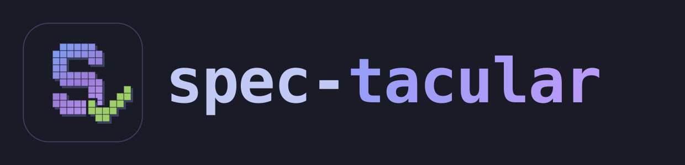
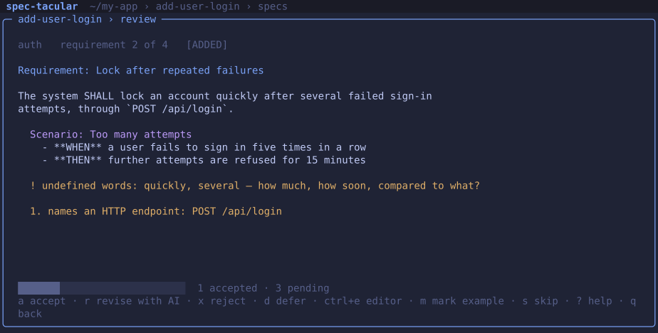
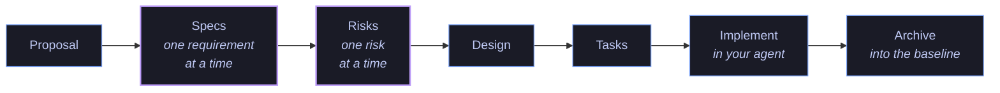
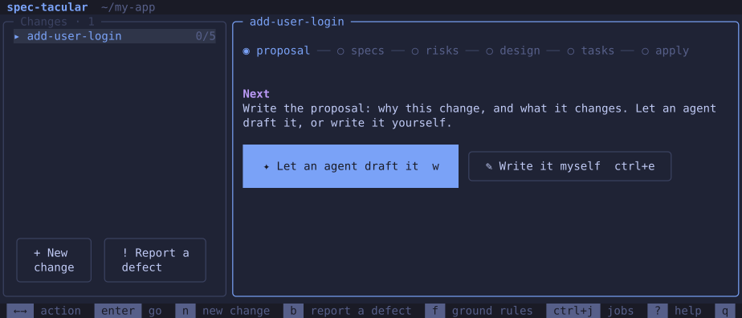
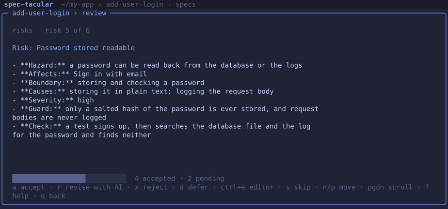
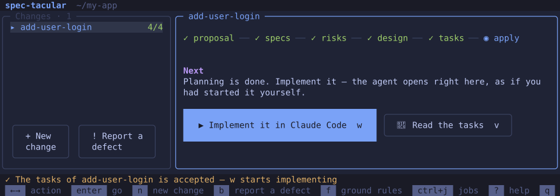
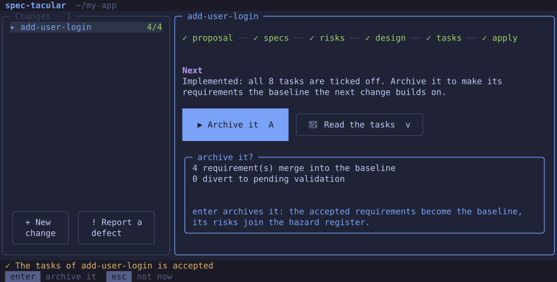

<p align="center">
  <a href="https://spec-tacular.app">
    
  </a>
</p>

<p align="center">
  <b>Your agent writes the spec. You decide what gets built.</b><br>
  A terminal UI for spec-driven development on top of <a href="https://github.com/Fission-AI/OpenSpec">OpenSpec</a>,<br>
  for <a href="https://docs.anthropic.com/en/docs/claude-code">Claude Code</a> and <a href="https://opencode.ai">opencode</a>.
</p>

<p align="center">
  <a href="https://github.com/wingfold-ai/spec-tacular/actions/workflows/ci.yml"></a>
  <a href="https://github.com/wingfold-ai/spec-tacular/releases/latest"></a>
  <a href="https://www.npmjs.com/package/@spec-tacular/cli"></a>
  <a href="https://scorecard.dev/viewer/?uri=github.com/wingfold-ai/spec-tacular"></a>
  <a href="LICENSE"></a>
</p>

<p align="center">
  <a href="https://spec-tacular.app">Website</a> ·
  <a href="https://spec-tacular.app/docs">Docs</a> ·
  <a href="https://spec-tacular.app/docs/getting-started/quickstart">Quickstart</a> ·
  <a href="https://github.com/wingfold-ai/spec-tacular/releases">Releases</a>
</p>

<p align="center">
  
</p>

Coding agents write requirements faster than anyone can read them, so they get skimmed and approved, and the agent builds things nobody agreed to. **spec-tacular puts every requirement your agent proposes in front of you, one at a time.** Accept it, reject it or defer it with one key, or have the agent revise just that one. Design and tasks are drafted only from what you accepted, and your agent implements those tasks.

## How it works

Each stage of a change is drafted by your agent and waits for you. Nothing moves on until you accept it.



Before the first change, a project gets its **ground rules** (domain, stack, architecture, conventions), and a new project a **vision** with a **roadmap** of small slices. Every agent reads them, so it builds on your decisions instead of making its own.

## What you get

<table>
  <tr>
    <td width="50%" valign="top">
      
      <br><b>The pipeline, always in view.</b> Every change shows where it stands and what comes next, as buttons.
    </td>
    <td width="50%" valign="top">
      
      <br><b>Risks guarded by tests.</b> Each risk gets a guard task, and its test must be shown to fail without the fix.
    </td>
  </tr>
  <tr>
    <td width="50%" valign="top">
      
      <br><b>Your agent, your setup.</b> Drafts are written in the background. Once the plan is accepted, implementing opens Claude Code or opencode in a tab of its own.
    </td>
    <td width="50%" valign="top">
      
      <br><b>Nothing silently forgotten.</b> Archiving merges what you accepted into the baseline; what you deferred is kept with what would verify it.
    </td>
  </tr>
</table>

And more:
- Vague words ("quickly", "several"), happy-path-only scenarios and premature details like a named endpoint are **flagged** before you accept.
- Edit or redraft an accepted text and it **waits to be read again**.
- If two accepted requirements conflict, the agent **stops and reports** instead of designing around it.
- Every decision is written to **`review.md`** in the change folder, so it goes through pull requests with the rest.
- **`spec-tacular evidence`** and **`hazards`** exit non-zero while something is unverified, so CI can gate on them.

## Install

spec-tacular is a single binary for **Linux and macOS** (x64 and arm64). It drives the [OpenSpec](https://github.com/Fission-AI/OpenSpec) CLI (1.11 or newer, OpenSpec 2 included) and your agent.

```bash
npm i -g @fission-ai/openspec        # OpenSpec, if you don't have it
npm i -g @spec-tacular/cli           # spec-tacular
```

Or without npm, from the latest GitHub release (checked against its `SHA256SUMS`, installed to `~/.local/bin`):

```bash
curl -fsSL https://spec-tacular.app/install.sh | sh
```

More options (a particular version, by hand, from source) are in the [installation guide](https://spec-tacular.app/docs/getting-started/installation).

## Quickstart

```bash
cd your-project
openspec init          # pick your agent: Claude Code or opencode
spec-tacular           # opens the TUI; for opencode: spec-tacular --driver opencode
```

The start screen walks you through setup, the ground rules and your first change. Press `?` for every key. The [quickstart](https://spec-tacular.app/docs/getting-started/quickstart) goes from here to a first accepted change, with screenshots of each step.

## Documentation

| | |
| --- | --- |
| [Getting started](https://spec-tacular.app/docs/getting-started/installation) | Install, the quickstart, starting a new project from a vision |
| [Guides](https://spec-tacular.app/docs/guides/reviewing) | Reviewing, the pipeline, ground rules, roadmap, decisions, risks, implementing and archiving, defects |
| [Advanced](https://spec-tacular.app/docs/advanced/consequence-classes) | Consequence classes, verification in CI, formal requirements |
| [Reference](https://spec-tacular.app/docs/reference/keys) | Keys, commands, files, configuration, troubleshooting |

## How it relates to OpenSpec

spec-tacular is not a new spec format. It keeps OpenSpec's folder layout and format, adds its own schema and a `review.md` per change, and keeps everything else in `spec-tacular/`. It works on an existing OpenSpec project, and if you stop using it you still have plain OpenSpec.

## Contributing

Bug reports, fixes and documentation are welcome. [CONTRIBUTING.md](CONTRIBUTING.md) covers the setup, the source layout, the checks and how a release happens. Questions and ideas go to [Discussions](https://github.com/wingfold-ai/spec-tacular/discussions); issues labelled [`good first issue`](https://github.com/wingfold-ai/spec-tacular/labels/good%20first%20issue) are a good place to start. Everyone taking part follows the [Code of Conduct](CODE_OF_CONDUCT.md).

Please report security problems privately, as [SECURITY.md](SECURITY.md) describes.

## License

[Apache 2.0](LICENSE) © Marius Högger. Release binaries embed the Bun runtime and other packages; their licences ship in each archive's `THIRD_PARTY_NOTICES.md`.
